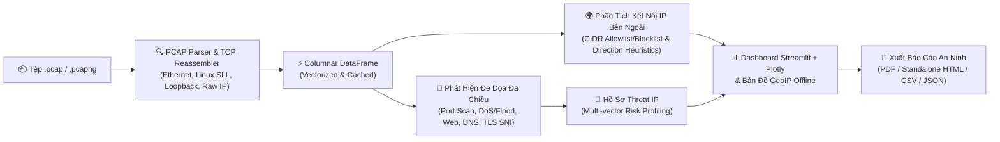

# 🛡️ Công Cụ Phân Tích & Trực Quan Hóa Mối Đe Dọa PCAP (PCAP Analyzer)


Dự án là công cụ hỗ trợ **SOC (Security Operations Center) & Network Forensics** phân tích lưu lượng mạng từ các tệp `.pcap` / `.pcapng`, phát hiện các hành vi tấn công phổ biến, giám sát kết nối ra IP public bên ngoài, trực quan hóa dữ liệu và xuất báo cáo an ninh mạng độc lập (PDF / HTML) 100% bằng Tiếng Việt.

---

## Kiến Trúc Luồng Phân Tích (System Architecture)



---

## 1. Tính Năng Chính

- 🛡️ **Phát hiện tấn công mạng đa chiều:**
  - **Port Scan:** Sliding-window hai chiều (two-pointer), đếm chính xác số cổng, phân tách phiên quét độc lập qua thời gian (cooldown sessionization).
  - **Flood & DoS / Connection Attempts:** Rolling-window peak PPS, tính toán lưu lượng và tỷ lệ trung bình từ cùng một bằng chứng (evidence window) nhất quán.
  - **Web Attacks:** Phát hiện SQL Injection, XSS, Path Traversal, Sensitive File, Remote Code Execution (RCE), Command Injection qua URL giải mã sâu (Double URL decoding) và User-Agent scanner.
  - **TLS SNI Analysis:** Trích xuất tên miền HTTPS từ ClientHello, phân loại C2 Direct IP, High Entropy DGA, Dynamic DNS khả nghi.
  - **DNS Probes & Tunneling:** Tách biệt Inbound DNS Probes với Outbound DNS Tunneling qua phân tích độ dài sub-domain và Shannon Entropy.
  - **Kết Nối Đến IP Lạ (External Connections):** Giám sát toàn diện các kết nối giữa máy nội bộ và IP public toàn cầu. Tự động suy luận hướng kết nối (Outbound / Inbound / Không xác định), phân loại 3 trạng thái trung lập (**Tin cậy**, **Chưa xác minh**, **Đáng ngờ** kèm lý do minh bạch), hỗ trợ cấu hình Allowlist & Blocklist dạng CIDR (IPv4/IPv6).
  - **Threat IPs:** Tổng hợp danh sách đối tượng đe dọa (Threat Actors) theo ma trận đa vector (Multi-vector) và gán mức độ rủi ro (Cao / Trung bình).
- 📊 **Trực quan hóa phong phú:** Biểu đồ tương tác Plotly (Giao thức, Dòng thời gian, Top IP, Phân bổ đe dọa, Kết nối IP lạ, Bản đồ thế giới).
- 🗺️ **Bản đồ địa lý IP:** Hiển thị vị trí địa lý của các IP nguồn đe dọa và IP bên ngoài (sử dụng GeoLite2-City offline).
- 📑 **Báo cáo an ninh độc lập:** Xuất báo cáo PDF hoặc HTML đầy đủ biểu đồ, có thể xem và in trực tiếp từ trình duyệt.
- ⚡ **Hiệu năng cao:** Thuật toán tiền lọc nhóm (cardinality pre-filtering) và mảng NumPy xử lý > 400.000 gói tin trong chưa đầy 15 giây.

---

## 2. Hướng Dẫn Sử Dụng Chức Năng “Kết Nối Đến IP Lạ”

1. **Truy cập tab:** Chọn mục `🌍 Kết Nối IP Lạ` trên menu thanh bên.
2. **Cấu hình Allowlist / Blocklist:**
   - Mở rộng mục `⚙️ Cấu Hình Allowlist / Blocklist IP` trên sidebar.
   - Nhập danh sách IP hoặc dải mạng CIDR (hỗ trợ cả IPv4 và IPv6, ví dụ: `8.8.8.8`, `1.1.1.0/24`, `2001:4860:4860::/48`), phân cách bằng dấu phẩy hoặc xuống dòng.
   - Hệ thống tự động bỏ qua mục nhập sai định dạng và đưa ra cảnh báo mà không làm gián đoạn chương trình.
3. **Phân loại kết quả:**
   - **Tin cậy (Trusted):** IP nằm trong Allowlist (mặc định bao gồm các DNS resolver công cộng an toàn như `8.8.8.8`, `1.1.1.1`...).
   - **Chưa xác minh (Unverified):** IP public bên ngoài thông thường, chưa phát hiện hành vi tấn công hay dấu hiệu bất thường. Hệ thống tuyệt đối không gắn nhãn nhóm này là "Malicious" hay "Threat Actor".
   - **Đáng ngờ (Suspicious):** IP có bằng chứng cụ thể: nằm trong Blocklist, liên quan đến Port Scan / Web Attack / DoS / DNS Tunneling, kết nối cổng dịch vụ rủi ro (Telnet, SMB, RDP, IRC Botnet, Tor...), hoặc kết nối dồn dập vượt ngưỡng.
4. **Bộ lọc & Xuất dữ liệu:** Lọc theo Trạng thái, Hướng kết nối, Mức rủi ro, Giao thức và xuất bảng ra CSV/JSON.

---

## 3. Yêu Cầu Hệ Thống & Cài Đặt

1. **Yêu cầu:** Python 3.10+ (khuyến nghị Python 3.12).
2. **Cài đặt thư viện phụ thuộc:**
   ```bash
   pip install -r requirements.txt
   ```
3. **Cơ sở dữ liệu GeoLite2 (Tùy chọn cho tính năng Bản đồ & Tra cứu vị trí):**
   - Công cụ hoàn toàn hoạt động offline. Để kích hoạt bản đồ tọa độ địa lý, vui lòng tải tệp `GeoLite2-City.mmdb` miễn phí từ [MaxMind](https://dev.maxmind.com/geoip/geolite2-free-geolocation-data) theo điều khoản giấy phép của MaxMind.
   - Đặt tệp `GeoLite2-City.mmdb` vào thư mục `data/` trong thư mục dự án (`pcap_analyzer/data/GeoLite2-City.mmdb`).

---

## 4. Hướng Dẫn Khởi Chạy

- **Khởi chạy bằng script tiện ích (Windows):**
   - Chạy tệp `run_app.bat` hoặc mở PowerShell: `.\run_app.ps1`.
- **Khởi chạy bằng lệnh Streamlit:**
   ```bash
   python -m streamlit run app.py
   ```
   Sau khi khởi chạy, mở trình duyệt tại địa chỉ: `http://localhost:8501`.
- **Trải nghiệm nhanh với tệp mẫu:** Tích chọn ô `🧪 Dùng tệp PCAP mẫu (demo_external.pcap)` trên thanh bên trái để kiểm thử ngay lập tức mà không cần tải tệp bên ngoài.

---

## 5. Khả Năng Kỹ Thuật & Giới Hạn (Technical Limitations)

- **Nguyên tắc nhận diện IP bên ngoài (External IP Rules):**
  - Sử dụng thư viện chuẩn `ipaddress`. Loại trừ 100% các dải Private IPv4/IPv6, Loopback (`127.0.0.0/8`, `::1`), Link-local (`169.254.0.0/16`, `fe80::/10`), Multicast (`224.0.0.0/4`, `ff00::/8`), Unspecified (`0.0.0.0`, `::`), Reserved (`240.0.0.0/4`), Broadcast (`255.255.255.255`), và các dải tài liệu RFC 5737 (`192.0.2.0/24`, `198.51.100.0/24`, `203.0.113.0/24`).
  - Khi người dùng chỉ định `server_ip`, địa chỉ này được coi là máy chủ nội bộ/giám sát và không bao giờ bị nhận diện nhầm thành IP lạ.
- **Suy luận hướng kết nối không trạng thái (Connection Direction Heuristics):**
  - Do PCAP có thể được bắt giữa chừng (mid-stream) không chứa đủ gói tin bắt tay TCP 3-way handshake (SYN, SYN-ACK, ACK), hướng kết nối được suy luận theo thứ tự ưu tiên: (1) Cờ TCP SYN không có ACK (bên gửi SYN là bên chủ động mở kết nối), (2) Phân tích cổng dịch vụ tiêu chuẩn (nếu cổng đích là cổng well-known HTTP/HTTPS/DNS thì bên kia là client), (3) So sánh tỷ lệ gói tin Inbound vs Outbound. Trong trường hợp không đủ thông tin kết luận, hướng sẽ được gắn nhãn minh bạch là "Không xác định".
- **Hỗ trợ Link-Layer Datalink:**
  - Hỗ trợ giải mã: Ethernet (`DLT_EN10MB`), Linux Cooked SLL (`DLT_LINUX_SLL`), Loopback (`DLT_NULL`, `DLT_LOOP`), và Raw IP (IPv4 / IPv6).
  - Các frame link-layer không thuộc danh mục trên hoặc bị cụt (truncated) sẽ được thống kê chi tiết trong siêu dữ liệu phân tích mà không làm gián đoạn chương trình.
- **Cơ chế TCP Stream Reassembly:**
  - Hỗ trợ ghép nối luồng TCP nhẹ có giới hạn bộ nhớ (tối đa 32 KB/luồng, quản lý 1.000 luồng đồng thời theo cơ chế LRU) chuyên phục vụ giải mã HTTP Request bị phân mảnh thành nhiều segment.
  - Không thay thế toàn bộ stateful TCP stack cho luồng dữ liệu tùy ý dung lượng hàng chục megabyte.
- **Tính Chất Heuristic & False Positives:**
  - Các quy tắc phát hiện dựa trên ngưỡng lưu lượng (PPS, cardinality), mẫu regex và entropy nhằm mục đích sàng lọc nhanh (rapid triage) trong SOC.
  - Người vận hành có thể tùy chỉnh các ngưỡng và danh mục cổng dịch vụ trong `modules/rules_config.py` để phù hợp với đặc thù mạng nội bộ.
- **Quyền Riêng Tư & An Toàn Tuyệt Đối:**
  - 100% dữ liệu PCAP được phân tích cục bộ (on-premises), không gửi bất kỳ thông tin nào ra Internet.
- **Giao Dịch Đóng Gói & Giới Hạn Phục Hồi (Distribution Transaction Limitations):**
  - Quá trình xuất bản 3 thành phần (`pcap_analyzer_export`, `PCAP_Analyzer_Project.zip`, `PROJECT_BUNDLE.md`) được quản lý bằng cơ chế giao dịch có nhật ký trạng thái (`.build_transaction.json`).
  - Mọi thao tác thay thế tệp/thư mục riêng lẻ (`os.replace`) có tính nguyên tử trên hệ thống tệp cục bộ. Khi phát sinh lỗi trong giai đoạn sao lưu hoặc xuất bản, hệ thống sẽ tự động rollback toàn diện cả 3 thành phần về đúng trạng thái ban đầu.

---

## 6. Kiểm Thử & Đóng Gói Phát Hành

- **Chạy toàn bộ bộ kiểm thử tự động (Unit Tests & Regressions):**
  ```bash
  python -m unittest discover tests
  ```
  *(Toàn bộ các bài kiểm tra logic, biểu đồ, báo cáo và các bài kiểm tra giao dịch đóng gói / rollback / crash recovery đạt 100%).*

- **Chạy bài kiểm tra hiệu năng (Benchmark Suite):**
  ```bash
  # Benchmark trên file PCAP mẫu thực tế
  python tests/bench_sample.py

  # Benchmark tổng hợp (Synthetic Benchmark cho CI / môi trường không có sample PCAP)
  python tests/bench_sample.py --synthetic
  ```

- **Đóng gói phát hành nguyên tử (Atomic Build & Distribution):**
  ```bash
  python scripts/build_distribution.py
  ```
  Script tự động thực hiện quy trình staging, chạy smoke test kiểm tra tính toàn vẹn SHA-256 và import module sạch từ bản phân phối trước khi thực hiện giao dịch cập nhật bản xuất `pcap_analyzer_export`, gói `PCAP_Analyzer_Project.zip` và tài liệu `PROJECT_BUNDLE.md`.
